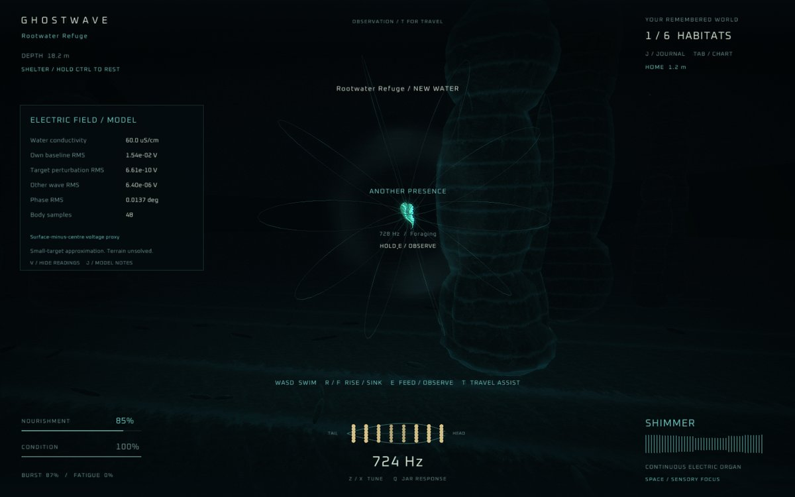
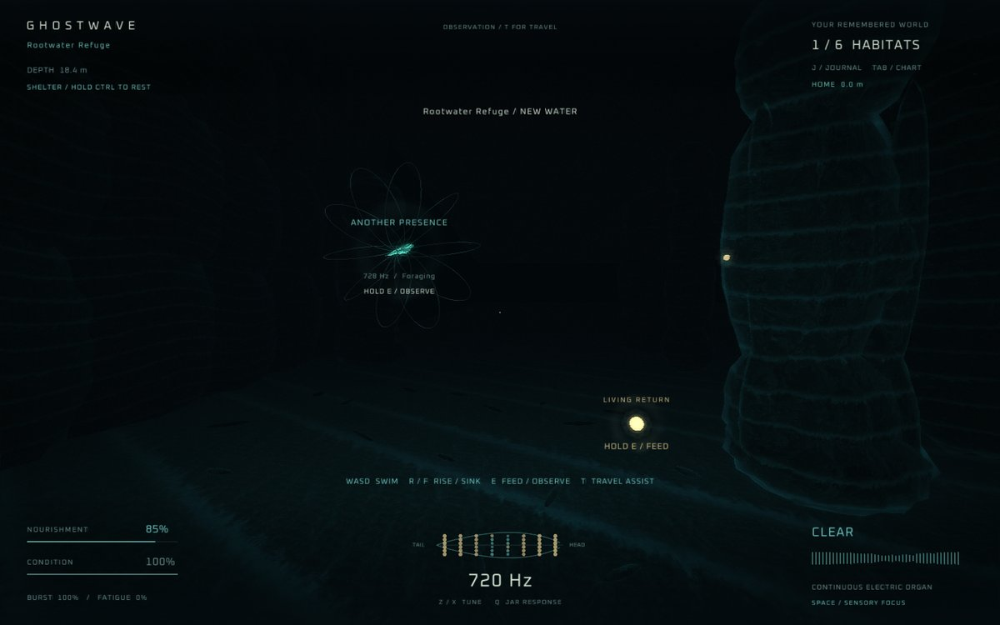

# GHOSTWAVE

GHOSTWAVE is a first-person exploration game about the brown ghost knifefish
(*Apteronotus leptorhynchus*), a weakly electric fish that senses its
surroundings through its own electric field. It is written in C++17 with
raylib 5.5.

The project has two parts:

- **A reusable electric-sense library** (`src/electrosense.*`). It computes
  fields in SI units: a current dipole in a conducting medium, the response of
  small spherical and spheroidal objects, voltages sampled over a body surface,
  and the interference (beats) produced when several wave-type fish emit at
  nearby frequencies. It has no dependency on graphics, audio or game state.
- **A game built on top of it.** The player swims through a generated
  240 x 160 m freshwater habitat with six regions, 24 fish of several species,
  prey, refuges and research sites. What is drawn on screen and heard is
  driven by the library's output, but it is an artistic interpretation of the
  signals, not a claim about what a fish perceives.

[docs/SCIENCE.md](docs/SCIENCE.md) describes the physics, cites the
literature the parameters are based on, and lists what is approximated or
uncalibrated. [docs/ARCHITECTURE.md](docs/ARCHITECTURE.md) describes how the
code is split.





The screenshots were captured with the full art set, which is not part of this
repository (see [Status and limitations](#status-and-limitations)).

## Build

Requirements: a C++17 compiler and CMake 3.20 or newer. The game target
downloads the pinned raylib 5.5 source on first configure, so it needs
internet access once. On Debian/Ubuntu the game also needs raylib's
dependencies: `libx11-dev libxrandr-dev libxinerama-dev libxcursor-dev
libxi-dev libgl1-mesa-dev`.

Headless library, tests and field laboratory (no graphics, audio device or
network needed):

```sh
cmake -S . -B build-core -DGHOSTWAVE_BUILD_GAME=OFF -DGHOSTWAVE_BUILD_FIELD_LAB=ON -DCMAKE_BUILD_TYPE=Release
cmake --build build-core --config Release --parallel
ctest --test-dir build-core -C Release --output-on-failure
```

Full game:

```sh
cmake -S . -B build -DCMAKE_BUILD_TYPE=Release
cmake --build build --config Release --parallel
./build/ghostwave
```

(Visual Studio: `build\Release\ghostwave.exe`)

The build copies `assets/` and `config/` next to the executable. On Windows,
`scripts/build.ps1` runs the same CMake steps (or compiles directly with a
w64devkit toolchain if one is unpacked under `local/w64devkit`), and `scripts/package.ps1`
zips a built game with its assets.

## Field laboratory

`field_lab` exercises the electric-sense library on its own and writes CSV
sweeps (object distance, water conductivity, material response vs frequency,
two-fish interference envelopes) plus a `manifest.json`. Every row is checked
against the closed-form result for its geometry (relative tolerance 1e-11);
the program exits non-zero if any check fails.

```sh
./build-core/field_lab --output-dir experiment --seed 5489
```

The same executable and seed produce byte-identical output.

## Controls

| Control | Action |
| --- | --- |
| Mouse | Look |
| WASD / arrows | Swim and strafe |
| R / F | Rise / sink |
| T | Toggle slow observation / travel assist |
| Space / left click | Brief sensory focus |
| Shift / right click | Burst (travel assist only) |
| Ctrl / C, held | Move quietly; rest while still inside a refuge |
| E, held | Feed, observe a nearby fish, or record a research site |
| Q | Upward frequency shift (jamming avoidance) |
| Z / X / mouse wheel | Manual frequency adjustment |
| Tab / J / V | Chart / journal / electric model readings |
| H | Hide HUD |
| F6 / F9 | Save / load |
| F5 | Reload `config/game.cfg` |
| M / F11 / Escape | Sound / fullscreen / pause |

Saves are written to `%APPDATA%\Ghostwave` on Windows and to
`$XDG_CONFIG_HOME/Ghostwave` (or `~/.config/Ghostwave`) elsewhere.

## Project layout

| Path | Contents |
| --- | --- |
| `src/electrosense.*` | Electric-field library (SI units, no game dependencies) |
| `src/sensory_frame.hpp` | Converts the current world state into library inputs and a bounded set of body-surface readings |
| `src/simulation.*` | Habitat generation, movement, fish behaviour, interactions, records, save/load |
| `src/audio.hpp` | Synthesized audio: wave-fish carriers and beats, pulse-fish trains, cues |
| `src/habitat_render.hpp`, `src/habitat_layout.hpp` | Terrain geometry and draw budgets |
| `src/main.cpp` | Application, camera, HUD and menus |
| `src/field_lab.cpp` | Headless experiment exporter |
| `tests/` | Habitat, electric-model and offline audio test suites |
| `config/game.cfg` | Gameplay tuning, reloadable at runtime |
| `assets/` | Shaders, font, particle sprites and third-party licences |

## Testing

`ctest` runs four suites: 150 habitat checks, 305 electric-model checks, 104
offline audio checks (the audio device is replaced by a test double), and a
seeded field-lab run that checks 2,392 rows against closed-form results. The
headless build compiles without warnings under `-Wall -Wextra -Wpedantic`.
Rendering, input and audio playback are not covered by automated tests.

## Status and limitations

- **Art textures are not included.** The game loads three textures:
  `assets/art/etched-basalt.png` (terrain material),
  `assets/art/knifefish.png` (fish sprite) and `assets/art/signal-title.png`
  (title screen). They are not part of this repository. Without them the game still builds; the code then shows an "ART OR SHADER
  MISSING" banner and `--smoke-test` returns a failure code. How the
  untextured scene looks was not checked. PNG files placed at those paths are
  loaded as-is (see `assets/art/README.md`).
- The electric model is a set of stated approximations (point dipole,
  small-object responses, no solved body or skin boundary). The tests check
  the implementation against closed-form results; they do not validate it
  against recordings from real fish. Fish behaviour, metabolism, water
  conditions and movement speeds are game rules, not fitted biology.
  `docs/SCIENCE.md` lists these limits in detail.
- Windows was the original packaging target. Other platforms, GPUs and
  controllers have not been tested.

## Licence

The code is released under the MIT licence (see `LICENSE`). Third-party
assets keep their own licences: the Oxanium font (SIL Open Font License 1.1),
one Kenney particle sprite (CC0) and raylib (zlib/libpng). The notices are in
`assets/licenses/`.
